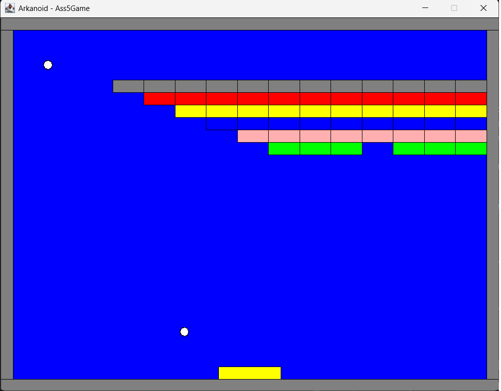

# Arkanoid

A 2D arcade game (Arkanoid / Breakout style) written in Java to practice
object-oriented design. Developed as part of an OOP course at
Bar-Ilan University.

## Features
   
- Ball physics with velocity vectors and real-time collision detection
- Collisions with the paddle, blocks and screen borders
- Blocks are removed when hit, and a counter tracks the blocks that remain
- Event-driven design using the Observer / Listener pattern
  (`HitListener`, `HitNotifier`), keeping game logic separate from rendering
- Animation loop running at 60 FPS
- [Controls, e.g. "paddle moves with the left / right arrow keys"]

## Design
| Class | Role |
|---|---|
| `Game`, `GameEnvironment` | Sets up and runs the game |
| `Ball`, `Paddle`, `Block` | Game objects |
| `Sprite`, `SpriteCollection` | Objects that can be drawn and updated |
| `Collidable`, `CollisionInfo` | Collision handling |
| `HitListener`, `HitNotifier` | Observer pattern for hit events |
| `BlockRemover`, `Counter` | Removes hit blocks and tracks the count |
| `Point`, `Line`, `Rectangle`, `Velocity` | Geometry and movement |

## Run
Requires JDK 17+ and the `biuoop` graphics library provided by the course
(not included in this repository).

    javac -cp biuoop.jar -d out src/*.java
    java -cp "out;biuoop.jar" [MainClass]

On Linux / macOS, use `:` instead of `;` in the classpath.
